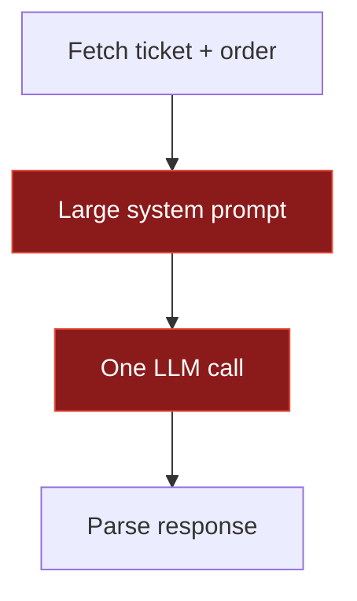
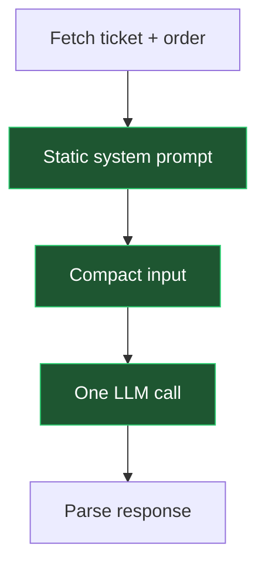
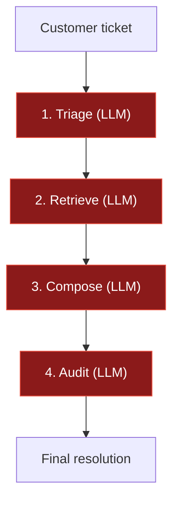
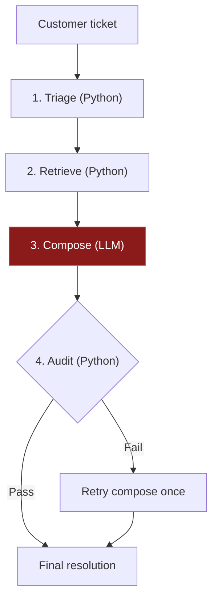

### Architecture, before and after

**Before**

**After**

| Step | Before | After |
|------|--------|-------|
| System prompt | Run ID, few-shot examples, help center, step-by-step instructions | Instructions and help center only, same on every call |
| Input | Indented order JSON | Thread and one-line order JSON |
| LLM output | ~480 tokens of reasoning | JSON only, ~46 tokens |

The static system prompt is passed as a cached prefix automatically once it
reaches 1,024 tokens. It is about 170 tokens today, so caching is not active.

## Question 2 — architecture, before and after

### Before: four LLM calls per ticket

### After: one LLM call per ticket

| Step | Before | After |
|------|--------|-------|
| Triage | LLM reads 120k chars of help center, restates ticket | Python extracts keywords from message and order |
| Retrieve | LLM asked to print 8 articles it cannot see | Python keyword search, top 3 articles |
| Compose | Full reasoning, triage pasted twice | Only LLM call: 3 articles, thread, order; JSON only |
| Audit | LLM reads 80k chars again, rewrites JSON | Python checks JSON, action and article; retries only on failure |
