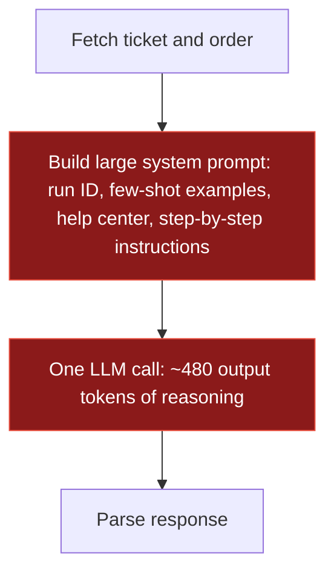
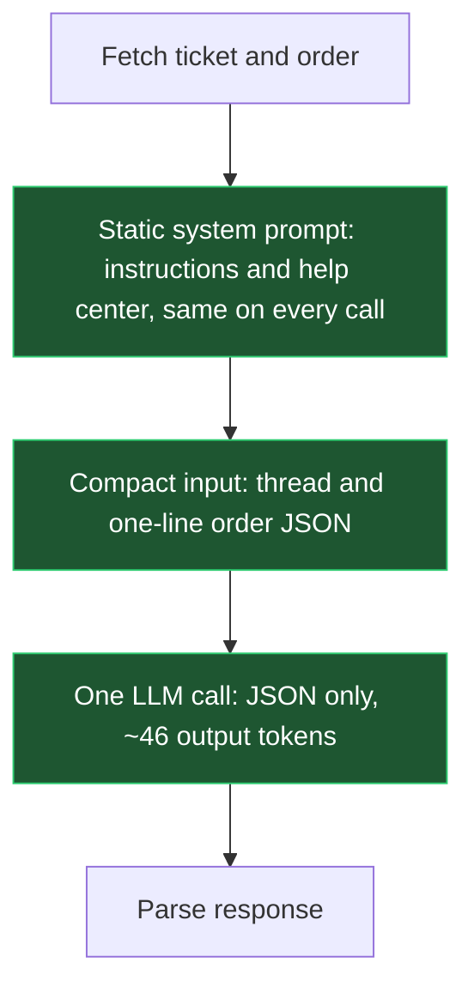
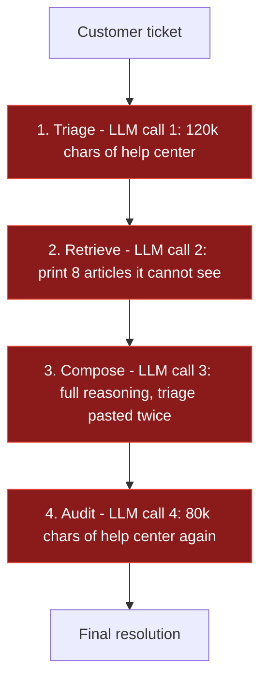
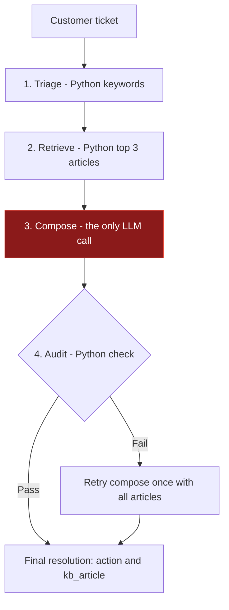

### Architecture, before and after

**Before**

**After**

The static system prompt is passed as a cached prefix automatically once it
reaches 1,024 tokens. It is about 170 tokens today, so caching is not active.

## Question 2 — architecture, before and after

### Before: four LLM calls per ticket

### After: one LLM call per ticket

