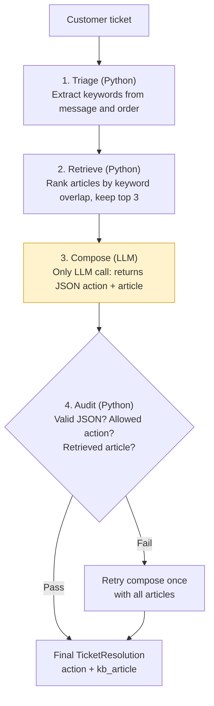

# Question 2 — SupportPipeline

## SupportPipeline architecture

Only `compose` calls the LLM on the normal path. Triage, retrieve and audit
are plain Python, so they cost zero points.

| Step | Baseline | Optimised |
|------|---------:|----------:|
| Triage | 32,679 | 0 |
| Retrieve | 2,478 | 0 |
| Compose | 10,899 | 1,566 |
| Audit | 27,447 | 0 |
| **Total (T-1001)** | **73,503** | **1,566** |
